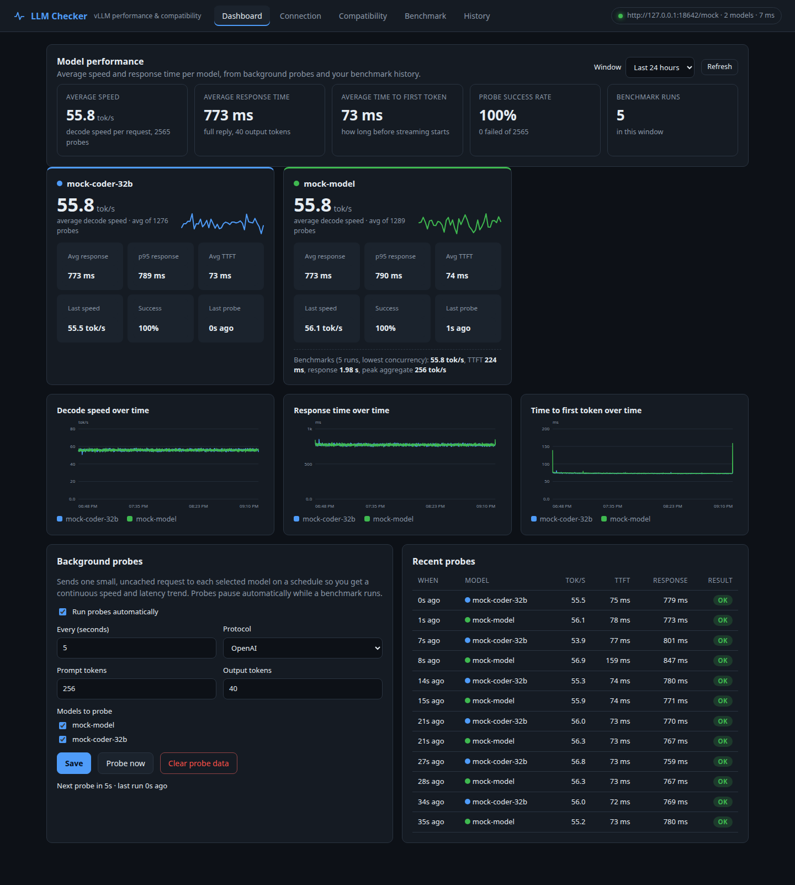
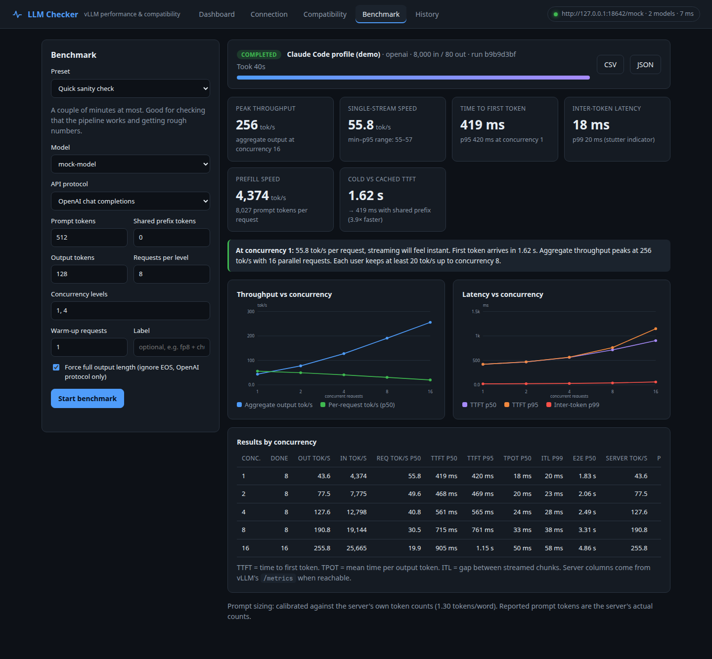
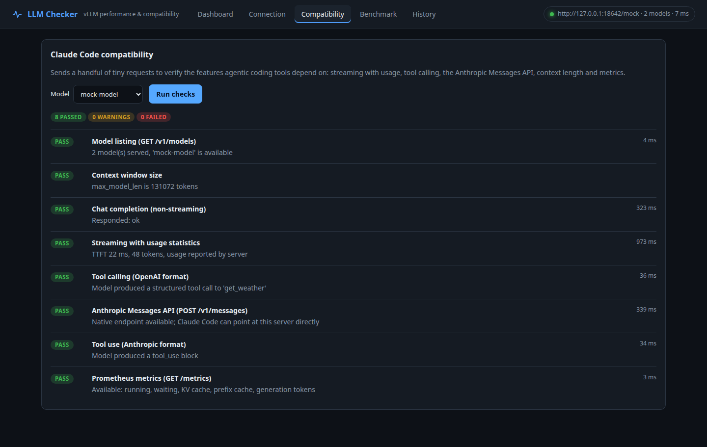
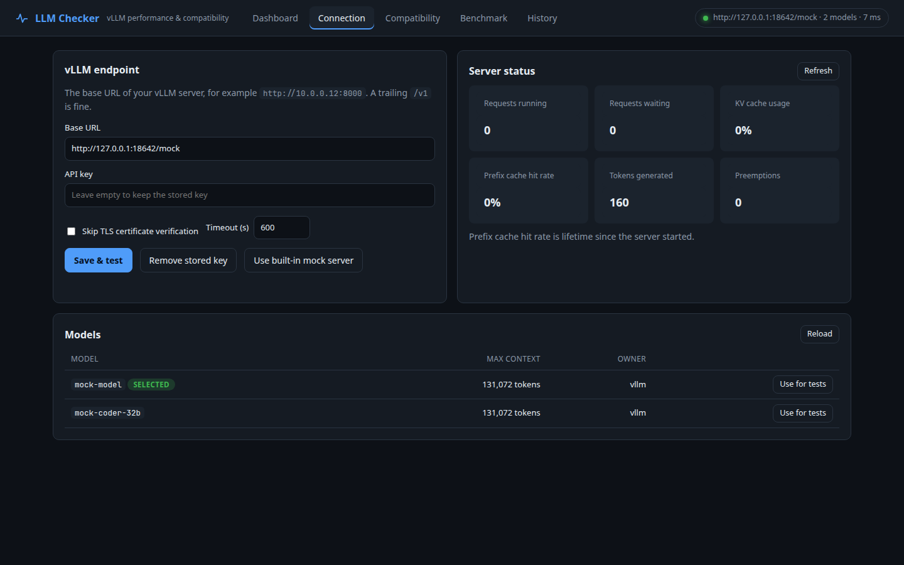
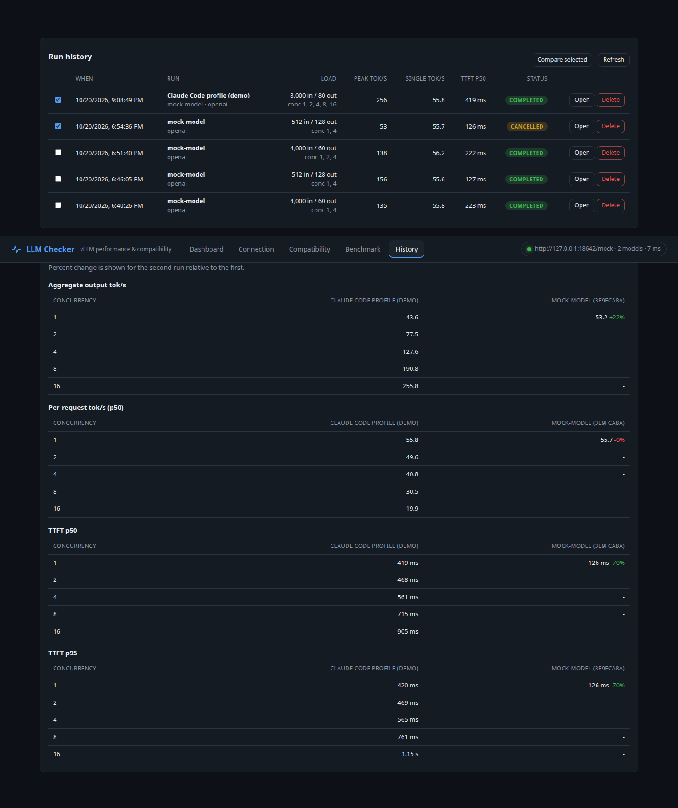
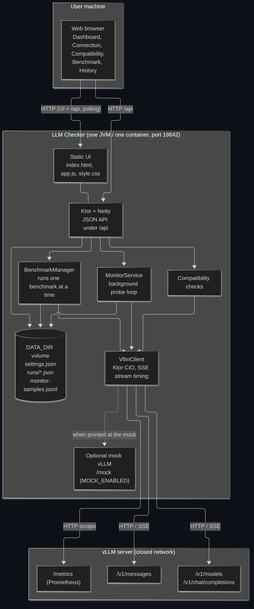

# LLM Checker

A small Ktor (Kotlin) web app that connects to a vLLM server, lists its models, checks that it can work with Claude Code, and benchmarks it: tokens per second, time to first token, behaviour under concurrency and prefix-cache effects.

It is built for closed networks. The UI is plain HTML, CSS and JavaScript served from the JAR. It loads nothing from a CDN, uses no web fonts and makes no outbound calls except to the vLLM server you configure.

## Features

- **Dashboard**: average tokens/sec and response time per model, over a window you pick (1 hour to all time):
  - per-model cards with average decode speed, a sparkline, average and p95 response time, average time to first token, and success rate
  - time-series charts of speed, response time and TTFT for every model
  - **background probes**: one small uncached request per selected model on a schedule (default every 60 s), so you get a continuous trend without running a benchmark. Probes pause automatically while a benchmark is running so they do not skew it. Probe samples are persisted under `DATA_DIR`.
  - benchmark history is folded in as well (the lowest-concurrency stage of each run, which is closest to what one developer experiences)
- **Connection**: base URL, optional API key, optional "skip TLS verification" for self-signed certificates. Lists models with their max context length. Shows live vLLM state from `/metrics` (running and waiting requests, KV cache usage, prefix-cache hit rate).
- **Compatibility checks** for what Claude Code relies on:
  - `GET /v1/models` and the model's `max_model_len`
  - chat completions, streaming, and whether the stream includes `usage`
  - OpenAI-format tool calling (needs `--enable-auto-tool-choice` and a `--tool-call-parser` on the server)
  - the native Anthropic `POST /v1/messages` endpoint, plus Anthropic-format tool use
  - `/metrics`
- **Benchmarks** over either the OpenAI or Anthropic protocol, with a concurrency sweep:
  - time to first token (TTFT), time per output token (TPOT), inter-token latency (ITL), end-to-end latency, each with p50/p90/p95/p99
  - per-request decode tokens/s and aggregate output and input (prefill) tokens/s
  - cold vs cached TTFT when a shared prefix is used, which models how an agent re-sends the same system prompt and file context every turn
  - server-side cross-checks scraped from `/metrics`: generation tokens/s, prefix-cache hit rate, peak running and waiting requests, peak KV cache usage, preemptions
  - presets: quick check, Claude Code agent session, concurrency stress sweep, long-context prefill
- **History** persisted to disk, with CSV and JSON export, and side-by-side comparison of runs (for example before and after changing a vLLM flag).
- A **built-in mock vLLM server** (opt-in) so you can try the app without a GPU.

### How prompts are sized

Prompt sizes are in tokens. Before each run the app sends two tiny calibration requests and uses the server's own `usage.prompt_tokens` to work out tokens per word for that model's tokenizer. Every request gets a unique run nonce, so earlier runs never pollute the prefix cache. The token counts shown in results always come from the server's usage block.

## Screenshots

**Dashboard**: average speed and response time per model, with probe trends.



**Benchmark results**: throughput and latency across a concurrency sweep, with cold vs cached time to first token.



**Compatibility checks** for Claude Code:



**Connection** and **history comparison**:





## Technologies

Kotlin 2.3 on JDK 21, Ktor 3.6 (Netty server, CIO client), kotlinx.coroutines, kotlinx.serialization, Logback, Gradle 9 (Kotlin DSL), and a dependency-free HTML/CSS/JS frontend with inline SVG charts. State is stored as plain JSON files. Packaged as a single fat JAR or a Docker image.

See [docs/ARCHITECTURE.md](docs/ARCHITECTURE.md) for the full technology table, the system topology, the source dependency map, and sequence diagrams of how a benchmark and the dashboard work.



## Run it

Requires JDK 21. Gradle is bundled through the wrapper.

```bash
# development
./gradlew run

# or build one self-contained JAR and run it anywhere with a JRE 21
./gradlew buildFatJar
java -jar build/libs/llm-checker.jar
```

Then open http://localhost:18642 and enter your vLLM URL on the Connection tab.

To try it without a vLLM server:

```bash
MOCK_ENABLED=true ./gradlew run
```

### Docker

```bash
docker build -t llm-checker .
docker run -d --name llm-checker -p 18642:18642 -v llm-checker-data:/data \
  -e VLLM_BASE_URL=http://your-vllm-host:8000 llm-checker
```

Or with compose (`VLLM_BASE_URL`, `VLLM_API_KEY` and `MOCK_ENABLED` are read from your shell or a `.env` file):

```bash
VLLM_BASE_URL=http://your-vllm-host:8000 docker compose up -d
```

The image is a two-stage build (Gradle and JDK 21 to compile, a slim JRE 21 to run), runs as a non-root user, keeps settings, history and probe data in the `/data` volume, and has a health check on `/api/health`.

For a closed network, build the image on a machine with internet access and carry it across:

```bash
docker save llm-checker | gzip > llm-checker.tar.gz     # online machine
gunzip -c llm-checker.tar.gz | docker load              # closed network
```

When vLLM runs on the Docker host itself, `localhost` inside the container is the container. Use the host's address instead, or on Linux add `--add-host=host.docker.internal:host-gateway` and use `http://host.docker.internal:8000`.

### Configuration (environment variables)

| Variable | Default | Purpose |
| --- | --- | --- |
| `PORT` | `18642` | HTTP port |
| `HOST` | `0.0.0.0` | Bind address |
| `VLLM_BASE_URL` | empty | Initial vLLM base URL (can be changed in the UI) |
| `VLLM_API_KEY` | empty | Initial API key |
| `DATA_DIR` | `./data` | Where settings and run history are stored |
| `MOCK_ENABLED` | `false` | Serve a fake vLLM at `/mock` and use it by default |
| `MOCK_SPEED` | `1.0` | Mock speed multiplier |

Settings saved in the UI (including the API key) are written to `DATA_DIR/settings.json` with `600` permissions. Run history is stored under `DATA_DIR/runs/`.

## Tests

```bash
./gradlew test
```

The integration tests start a real embedded server with the mock vLLM and exercise model listing, both streaming protocols, the compatibility checks, and a full benchmark run.

## HTTP API

| Method and path | Description |
| --- | --- |
| `GET/PUT /api/settings` | Read or update the connection settings (the API key is write-only) |
| `GET /api/models` | Models served by the configured vLLM |
| `GET /api/server-metrics` | Snapshot of vLLM's Prometheus metrics |
| `GET /api/dashboard?minutes=1440` | Per-model averages from probes and benchmark runs (`minutes=0` for all time) |
| `GET/PUT /api/monitor` | Read or change the background probe schedule, models and workload |
| `POST /api/monitor/probe` | Run one probe round now |
| `GET/DELETE /api/monitor/samples` | Raw probe samples (`?minutes=&model=`), or clear them |
| `POST /api/checks` | Run compatibility checks for `{ "model": "..." }` |
| `POST /api/runs` | Start a benchmark (one at a time) |
| `GET /api/runs`, `GET /api/runs/{id}` | List runs, or poll one run |
| `POST /api/runs/{id}/cancel`, `DELETE /api/runs/{id}` | Cancel or delete a run |
| `GET /api/runs/{id}/export.csv`, `.json` | Export per-request results |

## Notes on the numbers

- Run benchmarks when nobody else is using the server, or the results include their traffic. The server-side columns make this visible: peak running requests above your concurrency level means other users were active.
- With the Anthropic protocol the output length cannot be forced (there is no `ignore_eos`), so completions may be shorter than requested. Throughput numbers still use the real token counts.
- If the server does not send a `usage` block when streaming, token counts are estimated from the number of streamed chunks and results are flagged.
