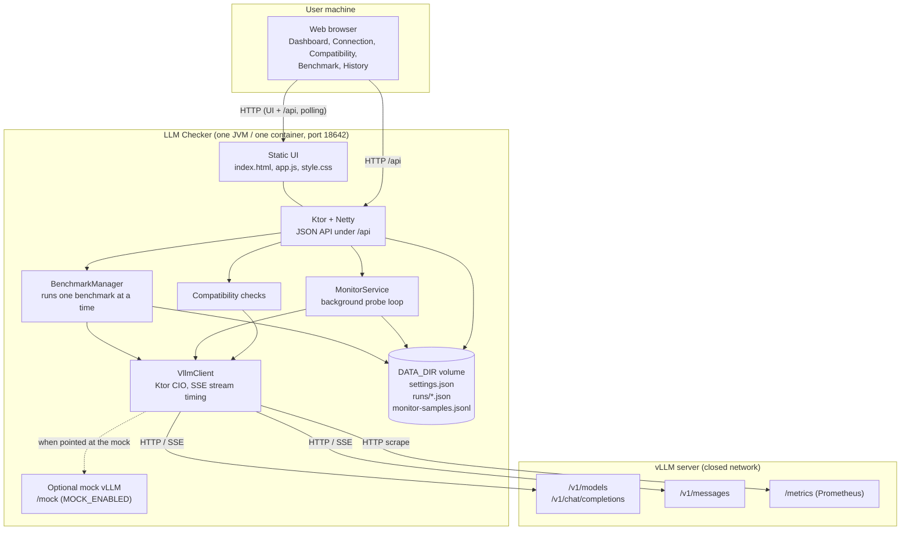
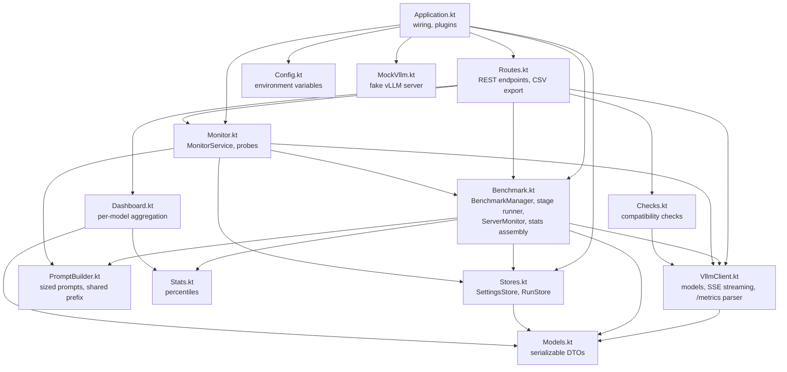
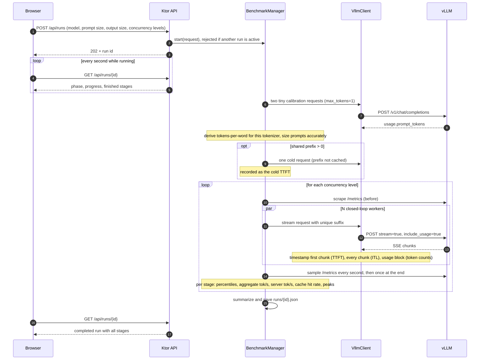
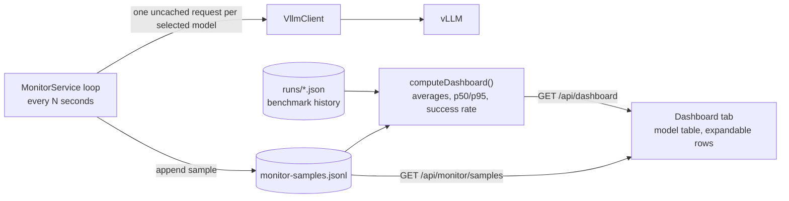
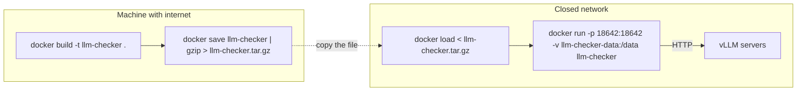

# Architecture

LLM Checker is a single JVM process. It serves a static web UI, exposes a small JSON API, and acts as an HTTP client towards your vLLM server. Nothing else is required at runtime: no database, no message broker, no external services.

## Technologies

| Layer | Technology | Version | Why |
| --- | --- | --- | --- |
| Language | Kotlin (JVM) | 2.3.21 | Requested stack; coroutines suit many concurrent streaming requests |
| Runtime | JDK / JRE | 21 | LTS release |
| Web framework | Ktor server | 3.6.0 | Routing, content negotiation, status pages, call logging |
| HTTP server engine | Netty (via Ktor) | bundled | Non-blocking server for the API and static UI |
| HTTP client | Ktor client with the CIO engine | 3.6.0 | Streams server-sent events from vLLM with per-chunk timing |
| Concurrency | kotlinx.coroutines | 1.11.0 | Concurrent benchmark workers, cancellation, background probe loop |
| JSON | kotlinx.serialization | 1.11.0 | API payloads, run history on disk, parsing vLLM responses |
| Logging | Logback (SLF4J) | 1.5.18 | Console logs |
| Build | Gradle (Kotlin DSL) with the Ktor plugin | 9.8.2 | `buildFatJar` produces one self-contained JAR |
| Tests | kotlin.test on JUnit Platform, Ktor server | - | Unit tests plus integration tests against the mock vLLM |
| Frontend | Plain HTML, CSS and JavaScript (ES2020) | - | No build step, no CDN, no web fonts, so it works on a closed network |
| Charts | Hand-written inline SVG | - | No charting library to download |
| Persistence | JSON and JSONL files in `DATA_DIR` | - | Settings, run history, probe samples |
| Packaging | Docker (multi-stage, Temurin 21) and docker-compose | - | Build once, copy the image into the closed network |

## System topology

The only outbound connections are from `VllmClient` to the vLLM base URL you configure. The browser only talks to LLM Checker.

## Source dependency map

Arrows mean "depends on". Files live in `src/main/kotlin/io/llmchecker/`.

External library dependencies: every file that handles JSON uses `kotlinx.serialization`; `Routes.kt` and `Application.kt` use Ktor server; `VllmClient.kt` uses Ktor client (CIO); `Benchmark.kt` and `Monitor.kt` use `kotlinx.coroutines`.

## How a benchmark works

### What gets measured

| Metric | Definition |
| --- | --- |
| TTFT | Time from sending the request to the first streamed content chunk |
| Decode tok/s (per request) | `(completion_tokens - 1) / (last chunk time - first chunk time)` |
| TPOT | Mean milliseconds per output token during decode |
| ITL | Gap between consecutive streamed chunks (reported as p50/p99, a stutter indicator) |
| E2E latency | Full request time, first byte out to stream end |
| Aggregate output tok/s | Total completion tokens across all requests divided by the stage wall time |
| Prefill tok/s | Total prompt tokens divided by the stage wall time |
| Server tok/s | Change in vLLM's `generation_tokens_total` counter divided by wall time (cross-check) |
| Prefix cache hit rate | Change in vLLM's prefix-cache hits divided by queries during the stage |

## How the dashboard works

- Probes are skipped while a benchmark is running, so they never skew benchmark results.
- Dashboard "average speed" is the mean of per-request decode tok/s over successful probes. Benchmark figures use the lowest-concurrency stage of each run, which is closest to one developer's experience.
- Both data sources are plain files, so the dashboard survives restarts and the container can be replaced without losing history as long as the `/data` volume is kept.

## HTTP API surface

| Method and path | Handled by |
| --- | --- |
| `GET/PUT /api/settings` | `SettingsStore` |
| `GET /api/models`, `GET /api/server-metrics` | `VllmClient` |
| `POST /api/checks` | `Checks.kt` |
| `POST /api/runs`, `GET /api/runs`, `GET/DELETE /api/runs/{id}`, `POST /api/runs/{id}/cancel`, exports | `BenchmarkManager`, `RunStore` |
| `GET /api/dashboard` | `Dashboard.kt` |
| `GET/PUT /api/monitor`, `POST /api/monitor/probe`, `GET/DELETE /api/monitor/samples` | `MonitorService` |
| `GET /api/health` | liveness, used by the Docker health check |

## Deployment in a closed network

Without Docker, copy `build/libs/llm-checker.jar` (about 33 MB, everything included) to any machine with a JRE 21 and run `java -jar llm-checker.jar`.
