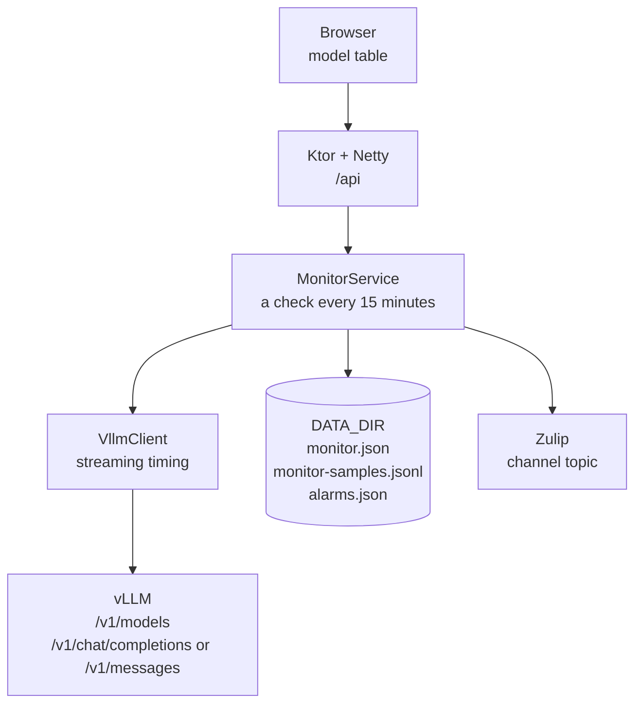

# Architecture

LLM Checker is one JVM process. It serves the dashboard and sends check requests to the vLLM server named by `VLLM_BASE_URL`.

`Application.kt` reads the environment and wires `MonitorService`. `Routes.kt` exposes health, the model list, the dashboard, and the probe schedule. `VllmClient.kt` lists models and times a streamed completion. `Dashboard.kt` turns stored samples into per-model averages. `MockVllm.kt` is a stand-in server used when `MOCK_ENABLED=true`.

A check builds a prompt of about the configured token count, streams the reply, and records tokens/sec, time to first token, response time, and the server's token counts. The table sorts models by average tokens/sec. Expanding a row shows the last five of those records. After each check, saved alarms compare that result with the selected baseline and, the first time a threshold is crossed, post to Zulip with the bot credentials from the environment.
